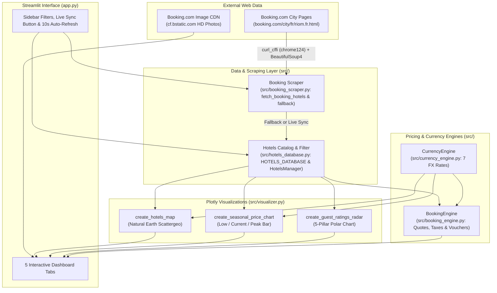

<h1 align="center">🏨 Global Hotel &amp; Booking.com Live Intelligence Platform</h1>

<p align="center">
  <strong>Interactive hospitality search, multi-currency pricing, and Booking.com live scraping intelligence platform built with Streamlit, Plotly, curl_cffi, and BeautifulSoup4 — combining a 20-property global &amp; regional catalog with on-demand Booking.com synchronization, interactive maps, seasonal pricing analytics, and itemized reservation voucher generation.</strong>
</p>

<p align="center">
  <a href="#-executive-overview--catalog-coverage"><b>Overview &amp; Catalog</b></a> •
  <a href="#-dashboard-modules--core-engines"><b>Modules &amp; Engines</b></a> •
  <a href="#-pricing-tax--currency-methodology"><b>Pricing &amp; FX Model</b></a> •
  <a href="#-system-architecture"><b>Architecture</b></a> •
  <a href="#-repository-structure"><b>Structure</b></a> •
  <a href="#-installation--usage"><b>Installation &amp; Usage</b></a> •
  <a href="#-data-sources-disclaimers--license"><b>Data &amp; License</b></a>
</p>

<p align="center">
  
  =1.35.0" />
  =5.18.0" />
  
</p>

<p align="center">
  
  
  
  
</p>

---

## 🎯 Executive Overview & Catalog Coverage

The **Global Hotel & Booking.com Live Intelligence Platform** (`app.py`) delivers an end-to-end hospitality search, rate-comparison, and reservation quoting interface. On startup, `HotelsManager` loads **20 curated properties across 11 destinations** (12 flagship luxury resorts, palaces, riads, and overwater villas across 10 international cities plus 8 verified Booking.com fallback properties in **Riom, France**), and supports on-demand live HTML scraping from **Booking.com** via `curl_cffi` TLS browser impersonation (`chrome124`) and `BeautifulSoup4`.

### Curated Destination Catalog (`src/hotels_database.py` & `src/booking_scraper.py`)

| Destination | Country | Properties Included | Property Types |
|---|---|---|---|
| **Marrakech** | Morocco | La Mamounia Palace Hotel (`RAK-001`), Royal Mansour Marrakech (`RAK-002`) | Historic Palace, Boutique Riad |
| **Casablanca** | Morocco | Four Seasons Hotel Casablanca (`CMN-001`) | Luxury Resort |
| **Dubai** | UAE | Burj Al Arab Jumeirah (`DXB-001`), Atlantis The Royal Palm (`DXB-002`) | Luxury Resort |
| **Riyadh** | Saudi Arabia | The Ritz-Carlton, Riyadh (`RUH-001`) | Historic Palace |
| **Paris** | France | The Ritz Paris (`PAR-001`) | Historic Palace |
| **London** | UK | The Savoy Hotel London (`LON-001`) | Historic Palace |
| **New York** | USA | The Plaza Hotel (`NYC-001`) | Historic Palace |
| **Tokyo** | Japan | Aman Tokyo (`TYO-001`) | Luxury Resort |
| **Maldives** | Maldives | Soneva Jani Overwater Resort (`MLE-001`) | Overwater Villa |
| **Istanbul** | Turkey | Çırağan Palace Kempinski (`IST-001`) | Historic Palace |
| **Riom** | France | 8 Booking.com properties (`RIOM-001`–`RIOM-008`, e.g., *B&B HOTEL*, *Campanile NATURE*, *Ace Hotel*, *Kyriad*, *ibis*, *ibis budget*, *La Caravelle*, *Charmant studio*) | Urban Hotel, Boutique Residence |

---

## 🧩 Dashboard Modules & Core Engines

The sidebar provides keyword filtering, a 10-second live auto-refresh toggle (`st_autorefresh`), an on-demand **Booking.com Scraper** trigger (`HotelsManager.sync_live_booking()`), and filters for maximum nightly USD rate, minimum star rating, property type, and required amenity. The main workspace spans **5 interactive tabs**:

| Dashboard Tab | Core Module & Functions | Implemented Features & Outputs |
|---|---|---|
| **🏨 Hotel Discovery & Listings** | `HotelsManager.filter_hotels()` (`src/hotels_database.py`) + `CurrencyEngine.format_price()` | Multi-criteria filtered property cards showing HD imagery (`cf.bstatic.com` for Booking.com entries), star ratings, review badges/counts, discount %, nightly & total-stay rates, and direct `Booking.com` links. |
| **🗺️ Interactive Map & Neighborhoods** | `create_hotels_map()` (`src/visualizer.py`) | Natural Earth `go.Scattergeo` map plotting filtered properties by `(lat, lon)`, colored on a `Viridis` USD rate scale with rich hover tooltips, paired with an expandable distance-to-center/airport dataframe. |
| **🛏️ Room Selection & Instant Booking Voucher** | `BookingEngine.calculate_stay_quote()` & `generate_booking_voucher()` (`src/booking_engine.py`) | Room class selector (`size_sqm`, bedding, `price_multiplier`, cancellation terms), guest details form, live itemized tax quote, and digital reservation voucher (`BKG-<5-digits>-<CITY>`). |
| **📊 Price Intelligence & Seasonal Deals** | `create_seasonal_price_chart()` (`src/visualizer.py`) | Grouped seasonal bar comparison (`Low_Season`, `Current`, `High_Season`) converted to the active display currency with calculated peak-vs-low nightly savings. |
| **⭐ Guest Reviews & Rating Analytics** | `create_guest_ratings_radar()` (`src/visualizer.py`) | Overall score (`out of 10`), review count, progress bars, and a 5-axis `Scatterpolar` radar across `Cleanliness`, `Location`, `Staff`, `Comfort`, and `Value for Money`. |

---

## 🧮 Pricing, Tax & Currency Methodology

### 1. Itemized Reservation Quoting (`src/booking_engine.py`)

For a selected hotel with base nightly USD rate $R_{\text{base}}$, room category multiplier $m_{\text{room}}$, stay length $N_{\text{nights}} = \max(1, \text{checkout} - \text{checkin})$, and room count $N_{\text{rooms}}$:

$$\text{Rate}_{\text{night}} = R_{\text{base}} \cdot m_{\text{room}}, \qquad \text{Subtotal}_{\text{USD}} = \text{Rate}_{\text{night}} \cdot N_{\text{nights}} \cdot N_{\text{rooms}}$$

Taxes and municipal surcharges are computed sequentially:

$$\text{VAT}_{\text{USD}} = 0.10 \cdot \text{Subtotal}_{\text{USD}}, \qquad \text{Service}_{\text{USD}} = 0.03 \cdot \text{Subtotal}_{\text{USD}}, \qquad \text{CityTax}_{\text{USD}} = \$5.00 \cdot N_{\text{nights}} \cdot N_{\text{rooms}}$$

$$\text{GrandTotal}_{\text{USD}} = \text{Subtotal}_{\text{USD}} + \text{VAT}_{\text{USD}} + \text{Service}_{\text{USD}} + \text{CityTax}_{\text{USD}}$$

### 2. Multi-Currency Conversion (`src/currency_engine.py`)

`CurrencyEngine` converts all USD base amounts using the configured `EXCHANGE_RATES` lookup table across **7 currencies**:

| Selector Label | ISO Code | Multiplier (`rate_to_usd`) | Display Format |
|---|---|---:|---|
| `USD ($)` | `USD` | `1.0` | `$1,250` |
| `EUR (€)` | `EUR` | `0.92` | `€1,150` |
| `MAD (د.م.)` | `MAD` | `10.15` | `12,688 MAD` |
| `SAR (ر.س)` | `SAR` | `3.75` | `4,688 SAR` |
| `AED (د.إ)` | `AED` | `3.67` | `4,588 AED` |
| `GBP (£)` | `GBP` | `0.79` | `£988` |
| `JPY (¥)` | `JPY` | `152.0` | `¥190,000` |

### 3. Booking.com Live Scraper Pipeline (`src/booking_scraper.py`)

`fetch_booking_hotels()` accepts a Booking.com destination URL (default `https://www.booking.com/city/fr/riom.fr.html`) or city slug, appends `selected_currency`, executes an HTTP GET request via `curl_cffi` (`impersonate="chrome124"`, falling back to `requests`), parses property cards and `images/hotel` tags with `BeautifulSoup`, upgrades thumbnail URLs (`square60`/`square200`/`square600` $\rightarrow$ `max1024x768`), caches entries in `_SCRAPE_CACHE` (`cache_ttl_seconds=300`), and reverts to `get_fallback_riom_hotels()` if the remote response is blocked or returns no cards.

---

## 🏗️ System Architecture



---

## 📂 Repository Structure

```text
hotel-booking-platform/
├── src/
│   ├── __init__.py                   # Package marker
│   ├── hotels_database.py            # 12 luxury hotels + Riom loader & HotelsManager filtering/sync
│   ├── booking_scraper.py            # curl_cffi + BeautifulSoup4 Booking.com scraper & Riom fallback
│   ├── booking_engine.py             # Stay quote, VAT/service/city tax & voucher generator
│   ├── currency_engine.py            # 7-currency static FX conversion & formatting engine
│   └── visualizer.py                 # Plotly Scattergeo map, seasonal bar & 5-pillar rating radar
├── app.py                            # Main Streamlit dashboard entrypoint (5 tabs + 10s refresh)
├── test_scraper.py                   # Standalone Booking.com Riom scraper verification script
├── extract_riom_data.py              # Standalone HTML extraction probe for Booking.com Riom listings
├── inspect_riom_full.py              # Diagnostic script checking bstatic hotel image URLs
├── inspect_riom_hotels.py            # Diagnostic script inspecting Booking.com property-card selectors
├── inspect_single_hotel.py           # Diagnostic script parsing a single Booking.com hotel page
├── scratch_test_booking.py           # Diagnostic probe checking JSON-LD and hotel links on Booking.com
├── scratch_test_search.py            # Diagnostic probe testing Booking.com searchresults.html parsing
├── requirements.txt                  # Python dependencies
├── LICENSE                           # Apache License 2.0
├── .gitattributes                    # Git text/EOL attributes
└── .gitignore                        # Python/venv/env ignore rules
```

---

## 🚀 Installation & Usage

### Prerequisites

- **Python**: `3.10+`
- **Dependencies** (`requirements.txt`): `streamlit>=1.35.0`, `pandas>=2.0.0`, `numpy>=1.24.0`, `requests>=2.31.0`, `plotly>=5.18.0`, `scipy>=1.11.0`, `streamlit-autorefresh>=1.0.1`, `curl_cffi>=0.7.0`, `beautifulsoup4>=4.12.0`
- No API keys or `.env` configuration are required.

### 1. Clone the Repository

```bash
git clone https://github.com/khalid-naami/hotel-booking-platform.git
cd hotel-booking-platform
```

### 2. Create Virtual Environment & Install Dependencies

**Windows (PowerShell):**

```powershell
python -m venv .venv
.\.venv\Scripts\Activate.ps1
pip install -r requirements.txt
```

**macOS / Linux:**

```bash
python3 -m venv .venv
source .venv/bin/activate
pip install -r requirements.txt
```

### 3. Launch the Dashboard

```bash
streamlit run app.py
```

### 4. Optional: Test the Booking.com Scraper via CLI

```bash
python test_scraper.py
```

---

## 🌐 Data Sources, Disclaimers & License

### External Data Sources & Feeds

- **Booking.com Destination Pages**: `https://www.booking.com/city/fr/riom.fr.html` (and user-supplied destination URLs/slugs) queried via `curl_cffi` + `BeautifulSoup4` in `src/booking_scraper.py`.
- **Booking.com Static Image CDN**: `https://cf.bstatic.com/xdata/images/hotel/max1024x768/...`

### Operational & Analytical Notice

- Digital confirmation vouchers generated in the **Room Selection & Instant Booking Voucher** tab are simulated client-side previews (`BookingEngine.generate_booking_voucher`) and do not execute live reservations or financial transactions; outbound reservations occur directly on Booking.com.
- Currency conversions use static reference multipliers defined in `src/currency_engine.py` rather than live FX market feeds.
- Live scraping depends on third-party HTML structure availability and network reachability; when blocked or offline, the platform gracefully serves verified fallback records.

### License

Distributed under the **Apache License 2.0**. See [`LICENSE`](LICENSE) for full terms.
